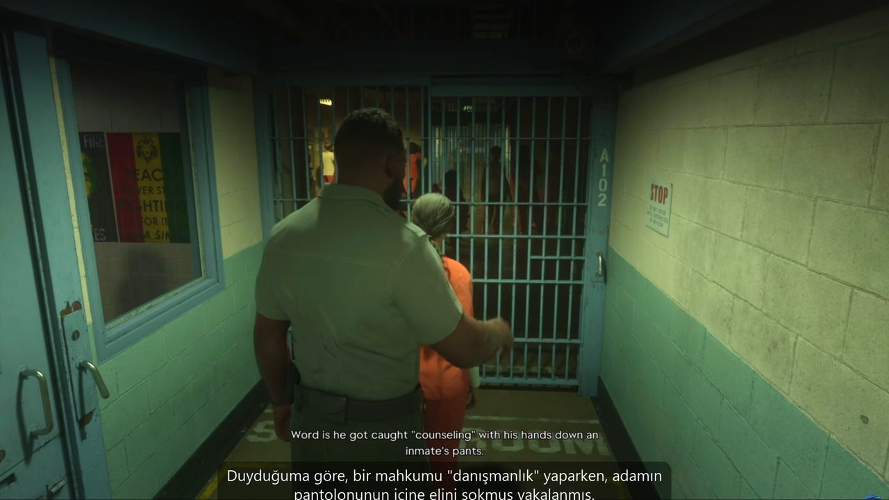
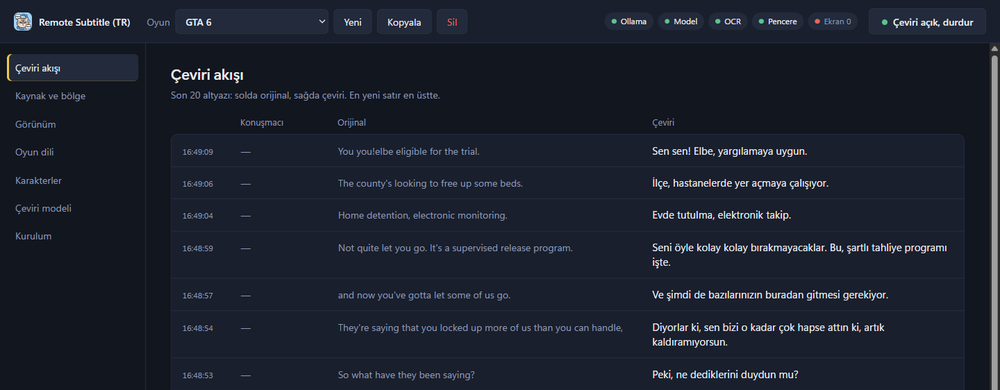
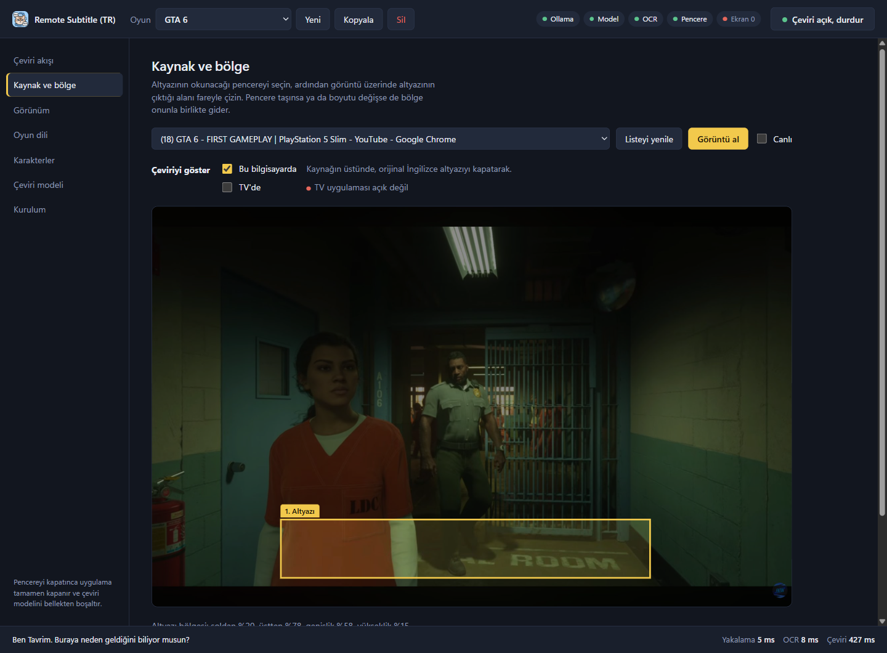
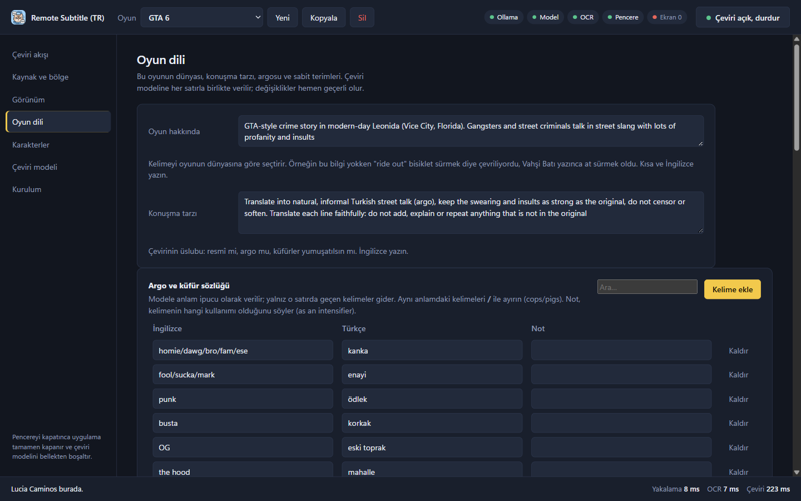
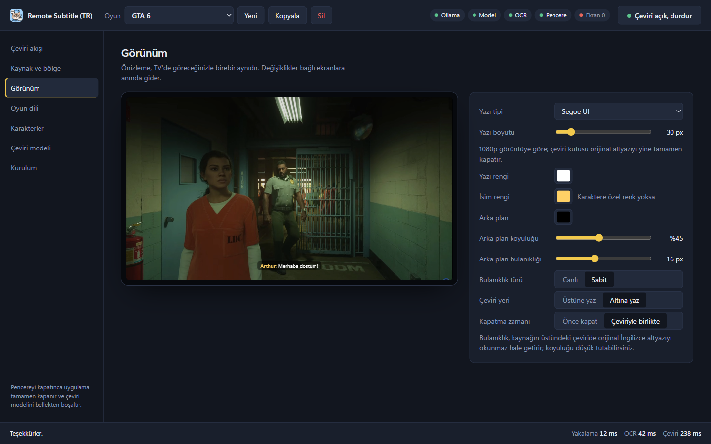

<p align="center">
  
</p>

<h1 align="center">Remote Subtitle (TR)</h1>

<p align="center">
  Oyunlardaki İngilizce altyazıları canlı olarak Türkçeye çevirir ve <b>TV'de oyun görüntüsünün üstünde</b> gösterir.
</p>

<p align="center">
  <a href="../../releases/latest"></a>
  
  
  <a href="LICENSE"></a>
</p>

<p align="center">
  
  <br><sub>Oyunda: orijinal altyazının altında Türkçesi (<i>Görünüm › Çeviri yeri › Altına yaz</i>). İstenirse çeviri orijinalin üstüne oturup onu kapatır.</sub>
</p>

Orijinal altyazıyı okur, bilgisayardaki yerel bir çeviri modeliyle çevirir ve çeviriyi orijinalin yerine (ya da
altına) yerleştirir. Her şey kendi bilgisayarınızda çalışır, internete metin gönderilmez: metni Windows'un kendi OCR'ı
okur, çeviriyi bilgisayardaki [Ollama](https://ollama.com) yapar. Satır başına çeviri süresi yaklaşık 0,2–0,5 saniyedir.

```
PS5 ──HDMI──▶ Samsung TV   (Remote Subtitle TV uygulaması: PS5 görüntüsü + üstünde çeviri)
 │                 ▲
 │ Remote Play     │ çeviri kutuları (ev ağı, Wi-Fi)
 ▼                 │
Bilgisayar: PS5 görüntüsü → altyazıyı oku → Türkçeye çevir → kutuyu TV'ye gönder
```

## Ekran görüntüleri

<table>
  <tr>
    <td width="50%"><br><b>Çeviri akışı</b>: son altyazılar, solda orijinali, sağda Türkçesi.</td>
    <td width="50%"><br><b>Kaynak ve bölge</b>: görüntü kaynağını seçin, altyazının çıktığı alanı fareyle çizin.</td>
  </tr>
  <tr>
    <td width="50%"><br><b>Oyun dili</b>: oyunun dünyası, konuşma tarzı ve aranabilir argo/küfür sözlüğü.</td>
    <td width="50%"><br><b>Görünüm</b>: yazı, renkler, buzlu cam arka plan; çevirinin üstte mi altta mı duracağı.</td>
  </tr>
</table>

---

## İçindekiler

1. [Ekran görüntüleri](#ekran-görüntüleri)
2. [Gerekenler](#gerekenler)
3. [Kurulum](#kurulum) — bir kez yapılır
   - [Adım 1 — Uygulamayı bilgisayara kurun](#adım-1--uygulamayı-bilgisayara-kurun)
   - [Adım 2 — Görüntü kaynağını bağlayın](#adım-2--görüntü-kaynağını-bağlayın)
   - [Adım 3 — Altyazının yerini gösterin](#adım-3--altyazının-yerini-gösterin)
   - [Adım 4 — TV uygulamasını kurun](#adım-4--tv-uygulamasını-kurun)
4. [Her oyunda kullanım](#her-oyunda-kullanım)
5. [Ayarlar](#ayarlar)
6. [Sorun giderme](#sorun-giderme)
7. [Kaldırma](#kaldırma)
8. [Geliştirme](#geliştirme)
9. [Lisans](#lisans)

---

## Gerekenler

| | Gereken | Not |
|---|---|---|
| 💻 | **Windows 10 veya 11** (64 bit) bilgisayar | |
| 🎮 | **Ekran kartı**, en az 5 GB bellek (NVIDIA önerilir) | Bellek arttıkça çeviri iyileşir: 5 GB → TranslateGemma 4B, 10 GB → 12B, 20 GB → 27B. Uygulama kartınıza uygun modeli kendisi seçer. |
| 📺 | **Samsung Tizen TV** ve bir **Samsung hesabı** | Yalnızca çeviriyi TV'de görmek için. Denendi: 2024 model QE75QN800DTXTK. Tizen Studio **gerekmez**. |
| 🕹️ | **PS5** ve bir **PSN hesabı** | Ya da bilgisayardaki herhangi bir pencere (video, chiaki-ng…) |
| 🌐 | Bilgisayar, TV ve PS5 **aynı ev ağında** | Kablolu ya da Wi-Fi |
| 💾 | Boş disk alanı | Ollama kurulum dosyası ~1,9 GB, çeviri modeli 3,3–17 GB (seçilen modele göre) |

---

## Kurulum

Kurulum bir kez yapılır. En uzun kısım Ollama'nın ve çeviri modelinin indirilmesidir.

### Adım 1 — Uygulamayı bilgisayara kurun

1. **[Releases](../../releases/latest)** sayfasından **`remote-subtitle-setup.exe`** dosyasını indirin.
2. Dosyayı çalıştırın. Windows yönetici izni ister: **Evet**.
3. Sihirbazda **İleri**'ye basarak ilerleyin. İsterseniz *Windows ile başlat* ve *Masaüstü kısayolu* seçeneklerini
   işaretleyin. Sihirbaz kendiliğinden şunları yapar:
   - Uygulamayı `C:\Program Files\remote-subtitle` klasörüne kurar.
   - Bilgisayarda **Ollama** yoksa indirir ve kurar (~1,9 GB, birkaç dakika sürebilir).
   - TV'nin bilgisayara bağlanabilmesi için Windows güvenlik duvarına izin ekler (TCP 8765).
4. Kurulum bitince **Remote Subtitle (TR)** açılır. İlk açılışta ekran kartınıza uygun **çeviri modelini kendiliğinden
   indirir** (3–17 GB; ilerlemesi *Çeviri modeli* sekmesinde görünür).

✅ **Kontrol:** Pencerenin sağ üstündeki **Ollama**, **Model** ve **OCR** göstergeleri **yeşil** olmalı.
Model inerken *Model* göstergesi kırmızıdır; inince yeşile döner.

> Windows OCR için dil paketi kurmanız gerekmez: Türkçe Windows'ta hazır gelen OCR İngilizce altyazıyı da okur.

### Adım 2 — Görüntü kaynağını bağlayın

Uygulamanın altyazıyı okuyabilmesi için oyun görüntüsünü görmesi gerekir. **PS5 için A yolunu** kullanın;
bilgisayardaki bir video ya da oyun için B yeterli.

#### A) PS5'e doğrudan bağlantı (önerilen)

Görüntü PS5'ten ev ağı üzerinden uygulamaya gelir; siz oyunu TV'de oynamaya devam edersiniz.
Uygulamada **Kurulum** sekmesi → **PS5 — doğrudan bağlantı**:

1. **PSN hesabını bağlayın**
   1. **Sony giriş sayfasını aç**'a basın. Tarayıcıda PlayStation giriş sayfası açılır.
   2. Remote Play için kullanacağınız PSN hesabıyla giriş yapın (oyun oynadığınız hesap olabilir, ayrı bir hesap da olabilir).
   3. Giriş sonrası açılan sayfa hata sayfası gibi görünebilir, **bu normaldir**. Tarayıcının adres çubuğundaki
      adresin **tamamını** kopyalayın (`https://remoteplay.dl.playstation.net/...` ile başlar).
   4. Adresi uygulamadaki kutuya yapıştırıp **Kaydet**'e basın.
2. **PS5 ile eşleştirin** (bir kez)
   1. PS5'te aynı PSN hesabıyla oturum açın.
   2. PS5'te **Ayarlar › Sistem › Uzaktan Oynama › Cihazı Eşleştir**'i açın. Ekranda **8 haneli bir kod** çıkar.
   3. PS5'in IP adresini öğrenin: **Ayarlar › Ağ › Bağlantı Durumu**.
   4. Uygulamaya PS5'in IP adresini ve 8 haneli kodu yazıp **Eşleştir**'e basın.
3. **PS5'i kaynak yap**'a basın.

İpuçları:
- PS5 aynı anda tek bir Remote Play bağlantısı kabul eder. PS Remote Play ya da chiaki-ng açıksa kapatın.
- TV'de "Uzaktan Oynama bağlandı" bildirimi çıkmasın: PS5'te **Uzaktan Oynama Bağlantı Durumunu Gizle**'yi açın.

#### B) Bilgisayardaki bir pencere

**Kaynak ve bölge** sekmesinde kaynak listesinden pencereyi (ör. tarayıcıdaki oyun videosu, chiaki-ng) ya da
monitörü seçin. Pencere **küçültülmemeli** ve başka bir pencerenin altında kalmamalı.

### Adım 3 — Altyazının yerini gösterin

Uygulama ekranın tamamını değil, yalnızca altyazının çıktığı alanı okur.

1. Oyunu altyazının göründüğü bir sahneye getirin.
2. **Kaynak ve bölge** sekmesinde **Görüntü al**'a basın.
3. Görüntünün üstünde altyazının çıktığı alanı **fareyle çizin**. Alanı altyazıdan biraz geniş, ama ekranın başka
   yazılarını (filigran, harita) içermeyecek kadar dar tutun.

Ayarlar o oyunun **profiline** kaydedilir. Her oyun için ayrı profil açabilirsiniz: üstteki **Oyun** menüsü →
**Yeni**. Bir oyunun profilini kopyalayıp yeni oyuna başlamak için **Kopyala**.

> Görev yazısı gibi başka yerlerdeki yazılar da çevrilsin isterseniz aynı sekmede **+ Bölge ekle** ile ek bölgeler
> çizin. Altyazı her zaman önce çevrilir, ek bölgeler biraz daha geç gelir.

### Adım 4 — TV uygulamasını kurun

Çeviriyi yalnızca bilgisayarda görecekseniz bu adımı atlayın.

Samsung, mağaza dışı uygulamaları yalnızca **geliştirici modundaki** TV'lere ve **o TV için alınmış bir
sertifikayla** kurmaya izin verir. Uygulama bunu sizin yerinize yapar; TV'nin kimliğini (DUID) bir yere yazmanız
gerekmez, TV'den kendisi okur.

**4.1 — TV'yi geliştirici moduna alın** (TV'de, bir kez)

1. Bilgisayarın IP adresine bakın: uygulamada **Kurulum** sekmesi → **Samsung TV uygulaması** bölümünde yazar.
2. TV'de **Uygulamalar** ekranını açın.
3. Kumandada sırayla **1 2 3 4 5** tuşlayın. *Developer mode* penceresi açılır.
4. **Developer mode**'u **On** yapın. **Host PC IP** kutusuna 1. maddedeki bilgisayar adresini yazın. **OK**.
5. TV'yi **güç tuşuna basılı tutarak** kapatıp açın (yeniden başlatma şart).

**4.2 — TV'yi bulun** (bilgisayarda, **Kurulum** sekmesi → **Samsung TV uygulaması**)

1. **TV'leri ara**'ya basın. Listede TV'nizin modeli ve kimliği (DUID) görünür.
2. TV bulunamazsa TV'nin IP adresini (*TV Ayarları › Genel › Ağ › Ağ Durumu*) kutuya yazıp **Ekle**'ye basın.

**4.3 — Samsung sertifikasını alın**

1. **Samsung ile giriş yap ve sertifika oluştur**'a basın. Tarayıcıda Samsung giriş sayfası açılır.
2. **Kendi Samsung hesabınızla** giriş yapın. Sertifika, listedeki TV(ler) için oluşturulur.
3. Listede TV'nin yanında **Sertifikada** yazmalı.

Sertifika bilgisayarınızda şifreli saklanır (`%APPDATA%\remote-subtitle\tv-cert`). Sonradan başka bir TV
eklerseniz aynı düğmeyle sertifikayı yenileyin.

> Tizen Studio'da oluşturulmuş bir sertifikanız varsa **Tizen Studio sertifikasını içe aktar** ile de kullanabilirsiniz.

**4.4 — Kurun**

1. Listede TV'nin yanındaki **Kur**'a basın. Uygulama TV'ye kurulur ve açılır.
2. TV'de **Uygulamalar** listesinde artık **Remote Subtitle (TR)** var.
3. TV uygulaması PS5 görüntüsünü HDMI 1'den alır. PS5 başka bir HDMI girişindeyse TV uygulamasında kumandanın
   **Kırmızı** tuşuna basın, HDMI numarasını yazın, **OK**.

✅ **Kurulum tamam.** Bilgisayarın IP adresi değişirse (ör. modem değişti) **Kur**'a yeniden basmanız yeterli.

---

## Her oyunda kullanım

1. Bilgisayarda **Remote Subtitle (TR)**'ı açın, üstteki **Oyun** menüsünden oyunun profilini seçin.
2. **Çeviriyi başlat**'a basın.
3. TV'de **Remote Subtitle (TR)** uygulamasını açın. PS5 görüntüsü tam ekran gelir, çeviriler üstünde çıkar.
4. **Oyunu TV uygulamasının içinden oynayın.** TV'nin kendi HDMI kaynağına geçerseniz uygulama arka plana düşer ve
   çeviri görünmez. TV uygulamasından **Geri** tuşuyla çıkılır.

Bitince bilgisayardaki pencereyi kapatın. Uygulama **Ollama da kapatılsın mı?** diye sorar:

| Seçim | Ne olur |
|---|---|
| **Evet** | Uygulama ve Ollama tamamen kapanır, arka planda hiçbir şey çalışmaz. |
| **Hayır** | Yalnızca uygulama kapanır; Ollama'yı kullanan başka bir programınız varsa çalışmaya devam eder. |
| **İptal** | Uygulama açık kalır. |

Her durumda çeviri modeli ekran kartı belleğinden hemen boşaltılır; ardından açacağınız oyun belleği geri alır.

**TV ile bağlantı durumu** (*Kaynak ve bölge › Çeviriyi göster › TV'de*):

| Durum | Anlamı |
|---|---|
| 🟢 TV ile iletişim var · ekranda | Her şey yolunda |
| 🟠 TV uygulaması arka planda | TV'de kaynak değişmiş ya da başka uygulama açılmış |
| 🟠 TV bağlı, yanıt bekleniyor | Bağlantı yeni açıldı |
| 🔴 TV yanıt vermiyor | TV uygulaması donmuş ya da kapanmış: kapatıp açın |
| 🔴 TV uygulaması açık değil | TV'de uygulamayı açın |

---

## Ayarlar

Hepsi oyun profiline kaydedilir; her oyun kendi ayarlarını taşır.

| Sekme | Ne ayarlanır |
|---|---|
| **Çeviri akışı** | Son çevrilen satırlar (orijinali ve çevirisi) |
| **Kaynak ve bölge** | Görüntü kaynağı, altyazı bölgesi, ek bölgeler (öncelik sırasıyla), çevirinin bilgisayarda ve/veya TV'de gösterilmesi |
| **Görünüm** | Yazı tipi ve boyutu, renkler, arka plan bulanıklığı; **Çeviri yeri** (orijinalin üstüne ya da altına); **Kapatma zamanı** (orijinal hemen kapatılsın ya da çeviriyle birlikte) |
| **Oyun dili** | **Oyun hakkında** (oyunun dünyası), **Konuşma tarzı** (ör. sokak argosu, küfürler yumuşatılmasın), **Argo ve küfür sözlüğü** (İngilizce → Türkçe, aranabilir), **Sabit terimler** (isim ve yerler her zaman aynı çevrilir) |
| **Karakterler** | Konuşan karakterler kendiliğinden eklenir; isim renkleri oyundan okunur, değiştirilebilir |
| **Çeviri modeli** | Ekran kartınıza göre önerilen modeli seçme ve indirme |
| **Kurulum** | PS5 bağlantısı ve TV uygulaması |

> **Oyun dili** sekmesine yazılanlar İngilizce olmalı (ör. *"1899 Wild West, outlaws on horseback"*). Argo sözlüğünden
> modele yalnızca o satırda geçen kelimeler gider; uzun bir sözlük çeviriyi yavaşlatmaz.

---

## Sorun giderme

| Belirti | Çözüm |
|---|---|
| Göstergelerden biri kırmızı | **Ollama**: Ollama'yı Başlat menüsünden açın. **Model**: *Çeviri modeli* sekmesinden indirin. **OCR**: Windows Ayarlar › Zaman ve dil › Dil'den İngilizce ya da Türkçe ekleyin. |
| "Ortalama … ms, daha küçük bir model deneyin" | Çeviri yavaş. Ekran kartını başka bir program (oyun, video düzenleyici) kullanıyor olabilir ya da model kartınız için büyük: *Çeviri modeli* sekmesinden daha küçüğünü seçin. |
| Çeviri anlamsız | Altyazı bölgesini yeniden çizin (başka yazıları içermesin). *Oyun dili* sekmesine oyunun dünyasını yazın. |
| TV'de "192.168.x.x geçici olarak çökmüş" | Bilgisayarda Remote Subtitle açık değil. Açın, sonra TV uygulamasını kapatıp açın. |
| TV bilgisayara bağlanamıyor | TV ve bilgisayar aynı ağda olmalı. Güvenlik duvarında TCP 8765 izni olmalı (kurulum ekler). |
| Çeviri TV'de görünmüyor | Oyunu TV uygulamasının içinden oynayın. *Kaynak ve bölge › Çeviriyi göster › TV'de* işaretli olmalı. |
| **TV'leri ara** TV'yi bulamıyor | Geliştirici modu açık mı, *Host PC IP* bu bilgisayarın adresi mi? Ayardan sonra TV güç tuşuyla yeniden başlatılmalı. |
| Kurulumda "imza/sertifika reddedildi" | TV sertifikada yok: **Samsung ile giriş yap ve sertifika oluştur** ile yenileyin, sonra **Kur**. |
| TV uygulaması *Uygulamalar* listesinde yok | **Kur**'a yeniden basın; yine görünmezse TV'yi kapatıp açın. |
| "Another Remote Play session is connected" | PS Remote Play, chiaki-ng ya da uygulamanın ikinci bir kopyası PS5'e bağlı. Kapatıp **Durumu yenile**. |
| Samsung girişi / sertifika oluşturma açılmıyor (şirket bilgisayarı) | Antivirüs engelliyor olabilir; BT'den istisna isteyin ya da ev bilgisayarında yapın. |

---

## Kaldırma

1. **Windows Ayarlar › Uygulamalar** → **Remote Subtitle (TR)** → **Kaldır**.
2. Ayarları ve TV sertifikasını da silmek için `%APPDATA%\remote-subtitle` klasörünü silin.
3. Ollama ve çeviri modelleri ayrı kurulur. Kaldırmak için **Uygulamalar** listesinden **Ollama**'yı kaldırın
   (modeller `%USERPROFILE%\.ollama` klasöründe durur).
4. TV'de: **Uygulamalar** ekranında **Remote Subtitle (TR)**'ı seçip silin (menünün yeri TV modeline göre değişir).
   İsterseniz *1 2 3 4 5* ile geliştirici modunu kapatın.

---

## Geliştirme

```
pip install -r requirements.txt
pip install --no-deps pyremoteplay==0.7.6   # netifaces bağımlılığı Python 3.14'te derlenmiyor; yerine netifaces-plus
python -m rsub              # panel penceresi
python -m rsub --headless   # yalnız sunucu (panel: http://127.0.0.1:8765/)
python -m pytest -q
```

- Gösterim sayfası (TV, ikinci ekran, tarayıcı): `http://<PC_IP>:8765/display.html`; arkaya video için `?bg=video.mp4`.
- TV uygulamasının ayrıntıları: [tizen/README.md](tizen/README.md).
- Ayarlar, profiller ve TV sertifikası: `%APPDATA%\remote-subtitle\`.

### Kurulum dosyasını derleme

Gerekenler: PyInstaller, Inno Setup 6 (`winget install JRSoftware.InnoSetup`) ve TV kurulumu için `sdb.exe`
(Tizen Studio'dan; `C:\tizen-studio\tools\sdb.exe` varsa betik pakete kopyalar).

```
powershell -NoProfile -ExecutionPolicy Bypass -File packaging\build.ps1
```

Çıktı: `packaging\Output\remote-subtitle-setup.exe`. Betiği ayrı bir `powershell -File` ile çalıştırın: PowerShell 5.1
içinden çıktısı yönlendirilerek çalıştırılırsa PyInstaller'ın bilgi satırlarını hata sayar.

Sürüm yayınlama: sürüm numarası `packaging/installer.iss` (`AppVersion`) ve `tizen/config.xml` (`version`) içinde.

```
gh release create v<sürüm> packaging\Output\remote-subtitle-setup.exe --title "Remote Subtitle (TR) <sürüm>" --notes-file notlar.md
```

### Ölçülen gecikme

2026-11-16, ikinci ekranda RDR2 oynanış videosu (2560×1600), RTX 5080 Laptop:

- Ekran yakalama 4–14 ms; OCR ortalama 4 ms / kare (9 satırdan 8'i doğru okundu).
- Çeviri (TranslateGemma 12B, tamamı ekran kartında): satır başına 225–471 ms. Ollama adresi `localhost` yerine
  `127.0.0.1` olmalı (Windows önce IPv6'yı deniyor, istek başına ~2 sn kaybettiriyordu).
- Satır ekranda 2 kare (~0,2 sn) değişmeden kalınca çevrilir; altyazı kalkınca çeviri, gelirken geciktiği kadar
  (0,5–4 sn) daha ekranda kalır.

---

## Lisans

GPL-3.0 (bkz. [LICENSE](LICENSE)). Kurulum dosyasına gömülü üçüncü taraf bileşenler ve lisansları:
[THIRD_PARTY_NOTICES.md](THIRD_PARTY_NOTICES.md).
